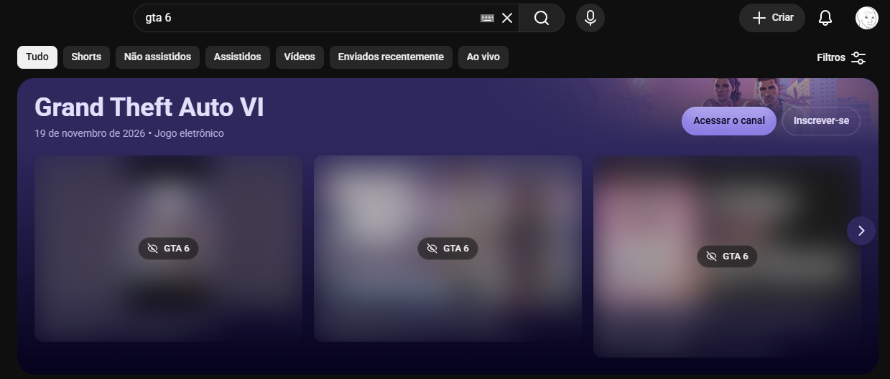
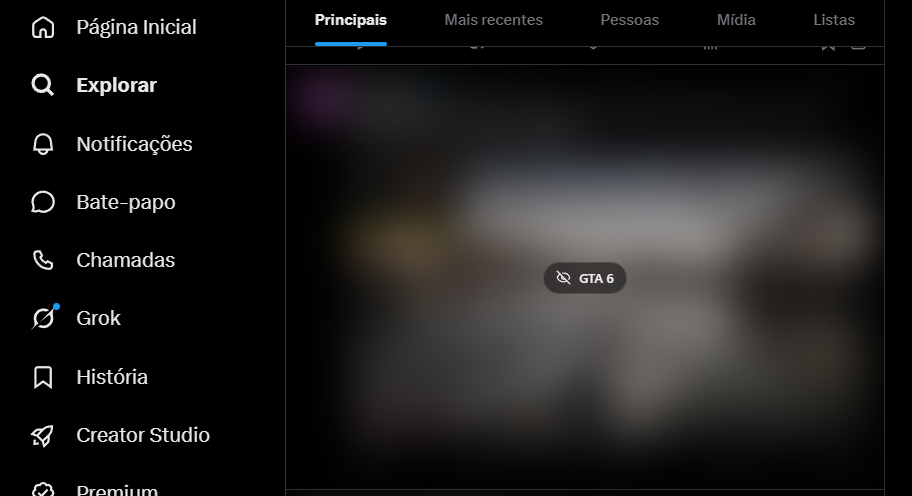
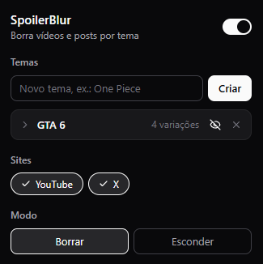
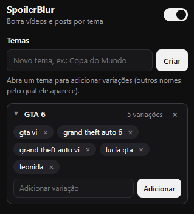
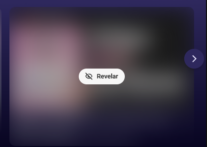

<p align="center">
  
</p>

<h1 align="center">SpoilerBlur</h1>

<p align="center">
  Extensão para navegadores baseados em Chromium (Chrome, Brave, Edge, Opera...) que borra vídeos do YouTube e posts do X sobre os temas que você escolher.<br/>
  Feita para fugir de qualquer spoiler.
</p>

<p align="center">
  
  
  
  
</p>

<p align="center">
  
</p>

<table>
  <tr>
    <td width="62%" align="center"></td>
    <td width="38%" align="center"></td>
  </tr>
  <tr>
    <td align="center">Post borrado no X</td>
    <td align="center">Temas, sites e modo no popup</td>
  </tr>
</table>

---

## O que ela faz

Você cadastra um tema (ex.: **GTA 6**) e, se quiser, outras formas de escrever o mesmo assunto (**GTA VI**, **Grand Theft Auto 6**, **Leonida**...). A partir daí, no YouTube e no X:

- **Thumbnails e títulos** que mencionam o tema ficam borrados, com uma etiqueta mostrando qual tema bateu.
- **Posts do X** (texto, imagem e vídeo) ficam borrados, inclusive **reposts e quotes**, e os vídeos deles não dão autoplay.
- **Ao abrir um vídeo** do tema, o player é pausado e coberto, com a opção "Assistir mesmo assim".
- **Um clique revela**, e um selo "Borrar" permite esconder de novo quando quiser.
- Você pode **borrar** ou **esconder** completamente, e ligar/desligar por site.
- Tudo atualiza **na hora**, sem precisar recarregar a página.

A busca ignora maiúsculas e acentos, e entende "GTA6", "gta 6" e "GTA-6" como a mesma coisa, sem pegar falsos positivos como "GTA Vice City" ou "GTA 60fps".

## O que ela não faz

Transparência é o ponto principal deste projeto, então vale deixar explícito:

| | |
|---|---|
| ❌ Não envia nenhum dado para lugar nenhum | Não existe servidor. O código não faz nenhuma requisição de rede. |
| ❌ Não tem analytics, rastreamento ou anúncios | Nenhum script de terceiros, nenhuma biblioteca externa. |
| ❌ Não lê suas senhas, mensagens ou histórico | Só roda em `youtube.com` e `x.com`, e só lê o texto dos vídeos/posts que aparecem na tela. |
| ❌ Não age em seu nome | Não curte, não segue, não comenta, não posta. Apenas muda o que **você** vê. |
| ❌ Não bloqueia anúncios nem altera as plataformas | Não mexe em nada do lado do YouTube ou do X. Ninguém além de você percebe que ela existe. |
| ❌ Não usa IA nem analisa imagens | A detecção é feita só pelo texto (títulos, legendas, nomes, hashtags). |

## Segurança e permissões

A extensão pede **o mínimo possível**:

| Permissão | Para quê |
|---|---|
| `storage` | Salvar seus temas e preferências no próprio navegador. |
| Acesso a `youtube.com` e `x.com` | Ler os títulos/textos que aparecem na tela e aplicar o blur. |

Não há permissão de abas, histórico, downloads, cookies ou "ler todos os sites".

### Onde ficam seus dados

Seus temas ficam salvos no armazenamento de extensões do próprio navegador (`chrome.storage.sync`). No Chrome com sincronização ativada, eles acompanham sua conta Google entre computadores; no Brave, ficam só naquele navegador. Ao desinstalar a extensão, tudo é apagado. Os vídeos que você revelou ficam só na memória da aba e voltam a ficar borrados ao recarregar a página.

### Confira você mesmo

O código é pequeno (cerca de 500 linhas de JavaScript puro, sem build, sem minificação, sem dependências) e pode ser lido em poucos minutos. Alguns jeitos rápidos de verificar:

- Abra o [`manifest.json`](manifest.json) e veja as permissões e os únicos sites onde ela roda.
- Procure por chamadas de rede no código: não há nenhum `fetch`, `XMLHttpRequest`, `WebSocket` ou `sendBeacon`.
  ```bash
  grep -rnE "fetch\(|XMLHttpRequest|WebSocket|sendBeacon" *.js
  ```
- Com a extensão ativa, abra o DevTools (F12) → aba **Network** e veja que nada é enviado por ela.

## Instalação

Por enquanto a extensão não está na Chrome Web Store, então a instalação é manual. Leva menos de um minuto:

1. Baixe o projeto: botão verde **Code → Download ZIP** (ou `git clone`) e descompacte.
2. Abra `chrome://extensions` (no Brave: `brave://extensions`, no Edge: `edge://extensions`).
3. Ative o **Modo do desenvolvedor**, no canto superior direito.
4. Clique em **Carregar sem compactação** e selecione a pasta do projeto (a que contém o `manifest.json`).
5. Fixe o ícone na barra de extensões e **recarregue** as abas do YouTube/X que já estavam abertas.

Funciona em qualquer navegador baseado em Chromium (Chrome, Brave, Edge, Opera, Vivaldi). Firefox não é suportado no momento.

> O navegador pode mostrar um aviso sobre extensões em modo desenvolvedor. Isso é normal para qualquer extensão instalada fora da loja.

### Atualizando

Baixe a versão nova, substitua a pasta, clique no botão de recarregar da extensão em `chrome://extensions` e recarregue as abas do YouTube/X.

## Como usar

1. Clique no ícone da extensão.
2. Digite um tema e clique em **Criar**. Dica: `Copa do Mundo, copa 2026, fifa` cria o tema já com duas variações.
3. Clique no tema para abrir e adicionar mais variações (outros nomes pelo qual o assunto aparece).
4. Escolha o modo (**Borrar** ou **Esconder**) e em quais sites ela deve funcionar.

<p align="center">
  <br/>
  <sub>Um tema com suas variações: qualquer uma delas faz o vídeo ou post ser borrado, e a etiqueta mostra o nome do tema.</sub>
</p>

Na página:

<p align="center">
  
</p>

- **Clique** num card borrado para revelar.
- Clique no selo **Borrar** de um vídeo revelado para esconder de novo.
- **Borrar tudo**, no popup, volta a esconder tudo o que você revelou.

A instalação já vem com um tema de exemplo, **GTA 6**, que pode ser apagado.

## Limitações

- A detecção é por texto. Um vídeo com título genérico ("olha isso 😳") e o spoiler só na imagem não é pego.
- YouTube e X mudam o código das páginas de tempos em tempos. Se algo parar de ser detectado, abra uma [issue](../../issues) com um print.
- Os vídeos revelados não são lembrados depois que você recarrega a página (de propósito).

## Estrutura do projeto

```
manifest.json   configuração da extensão (permissões e sites)
storage.js      configurações padrão e leitura/migração dos dados salvos
core.js         lógica comum: busca dos temas, blur, revelar/borrar
youtube.js      onde ficam os vídeos no YouTube + bloqueio do player
x.js            onde ficam os posts no X
content.css     visual do blur, etiquetas e botões
popup.html/js   tela de configurações da extensão
icons/          ícones
docs/           prints usados neste README
```

Para suportar outro site, basta criar um arquivo como o `x.js`, dizendo onde ficam os posts naquela página, e registrá-lo no `manifest.json`.

## Contribuindo

Sugestões, bugs e pull requests são bem-vindos. Se for reportar algo que não foi detectado, inclua um print e o link do vídeo/post.

## Licença

[MIT](LICENSE). Use, modifique e distribua à vontade.
